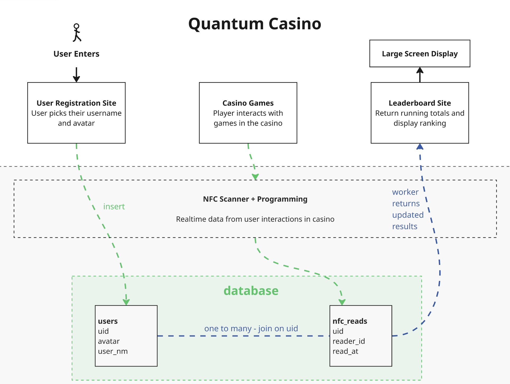

# Quantum Casino — Leaderboard



Please also see /example-video for videos of working reader interaction with site. 

The wall-screen leaderboard for an immersive quantum casino. Guests wear an NFC wristband; every tap at a game's reader is worth 100 points, and this board shows the top 10 by total, live, in a HUD style built to be read from across the room.

Spec: [AGENTS.md](AGENTS.md) · Plans: [docs/supabase-worker-plan.md](docs/supabase-worker-plan.md) (data layer, Assignment 5) and [docs/leaderboard-plan.md](docs/leaderboard-plan.md) (UI, Phase 1) · Task board: [kanban-list.md](kanban-list.md) · Diagram: [data-flow.png](data-flow.png)

## How the data flows

```
NFC reader (ESP32-C3 + PN532, repo a05-live-data) ──insert──▶ nfc_reads (uid, reader_id, read_at)
                                                                     │
Supabase Cron, every 10 s ──▶ Edge Function score-taps (THE WORKER)  │ reads tap_counts (view over nfc_reads),
                                                                     │ maps reader → game, 100 points per tap,
                                                                     ▼ writes only the rows that changed
users (uid, user_nm, avatar) ◀── join on uid ──▶ scores (uid, game_id, taps, score)   worker_state (heartbeat)
                                                                     │
                     Supabase Realtime push ──▶ apps/web (Next.js on Vercel) ──▶ GET /api/leaderboard ──▶ the board
```

- The readers never talk to the board and the board never reads the raw tap log: the worker in between is what Supabase Cron runs every few seconds.
- The worker is idempotent. Each run recomputes what every card should have and compares it with what is stored ("look for delta"), so a tap is never counted twice and deleting taps lowers scores again.
- The browser subscribes to `scores` and `users` over Realtime and refetches the ranked board on each push; a 15 s poll covers a dropped socket. The header pill says `LIVE · PUSH` when the socket is up, `LIVE · POLL` otherwise, and `WORKER IDLE` when the heartbeat is older than a minute.

## Repo map (monorepo)

```
apps/web/                       Next.js 16 app (the board). Vercel builds this folder.
  src/lib/readers.ts            reader → game map (esp32c3-1..5 → Uncertainty, Plinko, 17, Quant'em, Quabble)
  src/lib/leaderboard/          scoring.ts (pure: users + scores → ranked board) · getSnapshot.ts (Supabase reads)
  src/lib/hooks/useRealtimeRefresh.ts   the Realtime subscription
  src/app/api/leaderboard/route.ts      the JSON the board fetches
supabase/
  functions/score-taps/index.ts THE WORKER (Deno / TypeScript Edge Function)
  migrations/…_users.sql        users table + RLS            migrations/…_scores_worker.sql   tap_counts, scores, worker_state, Realtime
  seed.sql                      295 fake taps, 20 cards      seed_users.sql                  those 20 cards' names + avatars
  schedule.sql                  the Supabase Cron job (10 s) + Vault secrets
  config.toml                   Supabase CLI config (verify_jwt off for the worker)
docs/                           plans and layout screenshots
```

## Setup, first time

1. **Database.** In the Supabase dashboard → SQL Editor, run in this order:
   1. `a05-live-data/supabase/schema.sql` (creates `nfc_reads`; already done if the readers are logging)
   2. `supabase/migrations/20261102000001_users.sql`
   3. `supabase/seed_users.sql` and `supabase/seed.sql` (optional test data: 20 guests, 295 taps)
   4. `supabase/migrations/20261102000002_scores_worker.sql`
2. **Worker.** `npm install` at the repo root (installs the Supabase CLI), then

   ```bash
   npx supabase login                      # once, opens the browser
   npm run supabase:link -- <project-ref>  # the ref is the subdomain of your project URL
   npm run worker:deploy                   # supabase functions deploy score-taps --use-api --no-verify-jwt
   ```

3. **Schedule.** Run `supabase/schedule.sql` (enables pg_cron + pg_net, creates the 10 s job; `npm run db:sql -- supabase/schedule.sql` or paste it into the SQL Editor), then give the job its credential once, in the SQL Editor:

   ```sql
   select vault.create_secret('<your secret key, or the WORKER_SECRET token>', 'worker_key');
   ```

   Within 10 s the Functions → score-taps logs show a run and `scores` fills up (`npm run db:status`).
4. **Web env.** Copy `apps/web/.env.example` to `apps/web/.env` and fill in the project URL and the anon / publishable key, twice (server and `NEXT_PUBLIC_` for the browser socket).
5. **Run.** `npm run web:dev` → http://localhost:3000.
6. **Vercel.** Import the repo, set **Root Directory = `apps/web`**, add `NEXT_PUBLIC_SUPABASE_URL` and `NEXT_PUBLIC_SUPABASE_ANON_KEY` (the server reads those too), deploy.

## Scoring

| Reader | Game | Column |
|---|---|---|
| esp32c3-1 | Uncertainty | UNC |
| esp32c3-2 | Plinko | PLK |
| esp32c3-3 | 17 | 17 |
| esp32c3-4 | Quant'em | QTM |
| esp32c3-5 | Quabble | QBL |

Score per game = 100 × taps at that reader. Total = sum of the five. Ties go to whoever reached the total first, then username. Rows from any other `reader_id` (for example `laptop-test` from the smoke-test tool) are ignored. A wristband that taps before it has a `users` row shows as `GUEST-xxxx` (last four hex digits of its uid) with the fallback avatar and keeps its points when it is registered. Usernames are up to 16 characters; avatars are one of `qubit cat chip atom wave entangle dice chips spade lattice orbital tunnel`.

## Operating the worker

```sql
select jobid, jobname, schedule, active from cron.job;                                   -- is it scheduled?
select status, return_message, start_time from cron.job_run_details order by start_time desc limit 10;
select id, status_code, content::text from net._http_response order by id desc limit 10; -- what the function answered
select * from public.worker_state;                                                       -- heartbeat + last message
select cron.unschedule('score-taps-every-10s');                                          -- stop it
```

Logs: Dashboard → Edge Functions → score-taps → Logs, or `npm run worker:logs`. Run it by hand:

```bash
curl -s -X POST https://<project-ref>.supabase.co/functions/v1/score-taps -H "apikey: <secret key>"
# {"ok":true,"changed":0,"removed":0,"rows":100,"ignored_readers":1,"ran_at":"…"}
```

The function answers 401 to the anon / publishable key on purpose: only Cron (via the `worker_key` in Vault) and operators holding the project's secret key or the optional `WORKER_SECRET` token (`npm run worker:secret -- <token>`) may run it.

## Environment (`apps/web/.env`, git-ignored; template in `.env.example`)

| Variable | Purpose |
|---|---|
| `SUPABASE_URL`, `SUPABASE_ANON_KEY` | Server-side reads of `users`, `scores`, `worker_state` (RLS: select only). Fall back to the `NEXT_PUBLIC_` pair. |
| `NEXT_PUBLIC_SUPABASE_URL`, `NEXT_PUBLIC_SUPABASE_ANON_KEY` | The browser's Realtime socket. Without them the board polls only. |
| `SUPABASE_USERS_TABLE`, `SUPABASE_SCORES_TABLE` | Optional table names (defaults `users`, `scores`). |
| `NEXT_PUBLIC_POLL_MS` | Fallback poll interval, default 15000. |

## Scripts

| Command (repo root) | What it does |
|---|---|
| `npm run web:dev` / `web:build` / `web:start` | The Next.js app (or `cd apps/web && npm run dev`) |
| `npm run web:check` | ESLint, TypeScript (`next typegen && tsc`), Vitest |
| `npm run supabase:link -- <ref>` · `npm run worker:deploy` · `npm run worker:logs` · `npm run worker:secret -- <token>` | Supabase CLI: link, deploy the worker, tail its logs, set WORKER_SECRET |
| `npm run db:sql -- <file.sql>` · `npm run db:status` | Run a SQL file against the linked project · taps / scores / users / worker heartbeat at a glance |
| `cd apps/web && npm run shots` | Playwright layout check at 1920×1080 and 3840×2160 against a running server; PNGs in `docs/shots/` |
| `cd apps/web && npm run push-check` | Playwright end-to-end check of the push path: inserts a tap, runs the worker, waits for the board to move without a reload (run the dev server with `NEXT_PUBLIC_POLL_MS=600000` so only a Realtime push can move it), then removes the tap and waits for the revert |

## How the web app is put together

Next.js 16 (App Router, Turbopack, Cache Components on), React 19, Tailwind v4, `motion` for row animation, `swr` for the fallback poll, `@supabase/supabase-js` for reads and Realtime, Vitest for units.

- **Domain** — `src/lib/types.ts`, `src/lib/games.ts`, `src/lib/readers.ts`. `src/lib/ranking.ts` turns score rows into the ranked board; `src/lib/leaderboard/scoring.ts` maps `users` + `scores` rows (and guests) onto it. Both are pure and tested; `readers.test.ts` also checks that the worker's copy of the reader map matches.
- **Data** — `src/lib/leaderboard/getSnapshot.ts` reads the three tables with the anon key (paged, never cached); `src/app/api/leaderboard/route.ts` serves it (`connection()`, `Cache-Control: no-store`, 502 on failure so the last board stays on screen).
- **Page** — header and footer are the prerendered static shell; `BoardLoader` reads the first snapshot at request time (`io()` under `Suspense`) and hands it to `LiveLeaderboard`, which refetches on Realtime pushes and on the fallback poll. `BoardTable` animates reorders, count-ups, the ▲/▼ rank delta and the leader's crown. `LiveIndicator` reads a tiny store written by the fetcher and the socket.
- **Design tokens / avatars / kiosk** — unchanged from Phase 1: `src/app/globals.css`, `src/components/avatars/glyphs.tsx`, `src/components/shell/Kiosk.tsx` (cursor hides, `F` for fullscreen, reload every 6 h).

## Wall screen setup

Use a small PC / Raspberry Pi / Chromecast running Chromium rather than a TV's built-in browser (Next 16 targets Chrome 111+). Launch in kiosk mode and the board fills the screen:

```bash
chromium --kiosk --noerrdialogs --disable-infobars https://<your-deployment>/
```

On a laptop, press `F` for fullscreen. Phones and tablets get a stacked, scrollable layout, but the wall is the primary target.

## Not built yet

- The **User Registration Site** from the diagram (guest picks a username and avatar when the wristband is issued; it inserts into `users`). Until then, add guests in the Table Editor or with a SQL `insert`, as in `supabase/seed_users.sql`.
